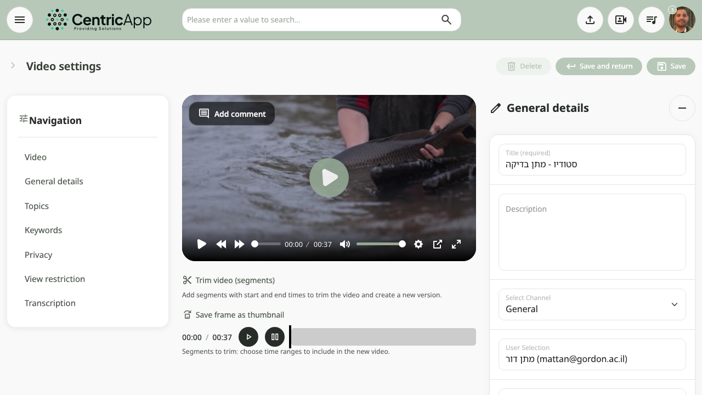
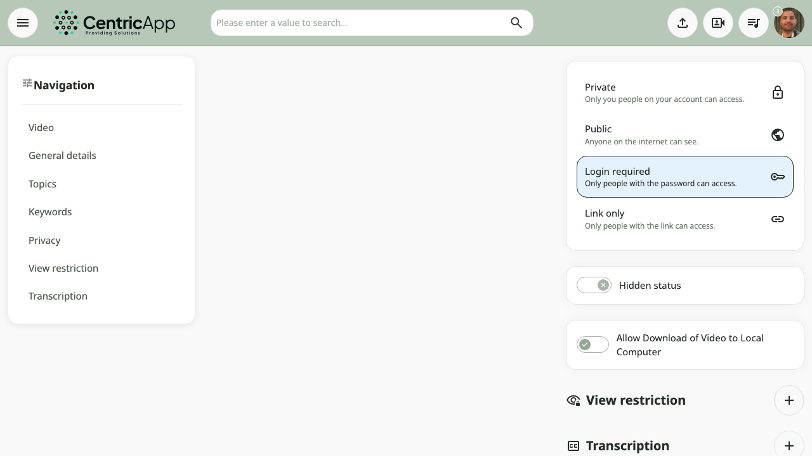
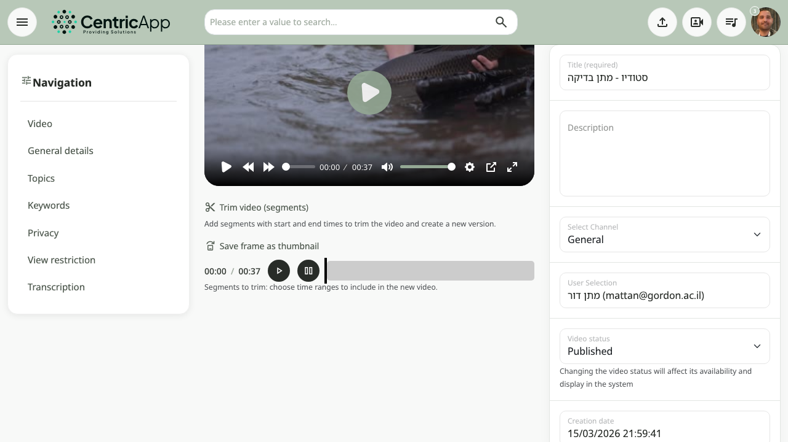

## Stream – User & Admin Guide

This guide explains how to use the Stream platform as a **regular user** and as an **administrator**.

---

## 1. Getting Started

### 1.1 Logging in

- Open the Stream URL in your browser.
- Enter your **email** and **password**, then click **Log in**.
- If you forgot your password, use **Forgot password** and follow the instructions sent by email.

### 1.2 Main layout (high level)

- **Top navigation bar** – access to search, upload, playlists, subscriptions, notifications, profile/settings and (for admins) the admin area.
- **Left or center content area** – lists of videos, playlists, channels, or analytics depending on the page.
- **Right side or below** – secondary information such as related videos, filters, or actions.

---

## 2. Regular User Guide

### 2.1 Browsing and watching videos

- From the home page you can:
  - Scroll and discover recommended or recent videos.
  - Click a video thumbnail or title to open the **watch page**.
- On the watch page:
  - Use the player controls (play / pause, volume, timeline, full screen).
  - Read the video title, description, publish date, and view count.
  - Use available actions: like / dislike, share, download, or open more options (depending on your configuration).

### 2.2 Searching for content

- Use the **search bar** in the header.
- Type a keyword (title, topic, speaker name, etc.).
- Press **Enter** or click the search icon.
- On the results page you can:
  - Filter videos using dropdowns or filters (if available).
  - Change sorting (e.g. newest, most viewed) when such options appear.

### 2.3 Playlists and subscriptions

- **Playlists**
  - Open the **Playlists** page from the main menu.
  - Browse available playlists; each playlist groups a set of videos by topic.
  - Click a playlist to see its videos and start playing them in sequence.

- **Subscriptions / top channels**
  - The **Subscriptions** page shows channels you follow (if this feature is enabled).
  - The **Top channels** / **Leading channels** page shows popular channels in the system.
  - From a channel page you can watch all videos from that creator and subscribe (if supported).

### 2.4 Notifications and comments

- **Notifications**
  - Open the **Notifications** page from the top bar.
  - You will see system messages such as:
    - New videos relevant to you.
    - Activity on your channel (e.g. comments).
    - Changes made by admins that affect your account.
  - Click any notification to go directly to the related video or page.

- **Comments / questions**
  - On the video watch page you may see a **comments** or **questions** section.
  - You can:
    - Read existing comments.
    - Add your own comment or question (if allowed).
    - In some setups, mark questions as helpful or important.

### 2.5 Your profile and settings

- **My channel / profile**
  - Use the profile menu in the header to open **My channel** or **Profile**.
  - Here you can see:
    - Basic profile details (name, email, avatar).
    - Your uploaded videos (if you have upload permissions).
    - Basic statistics (views, followers, etc., depending on configuration).

- **User settings**
  - Open **User settings** from the profile menu.
  - Typical actions:
    - Change your password.
    - Update personal details (where allowed).
    - Configure notification preferences (if the system exposes them).

### 2.6 Studio – creating a new video from segments (if enabled for regular users)

If the **Studio** feature is available to you, you can create a new video by combining segments from existing videos.

1. Open **Studio** from the header.
2. In the left panel, you will see a list of **available videos**.
3. For each video you want to use:
   - Click **Add segment**.
   - A modal opens with a timeline of the selected video.
   - Drag the **start** and **end** handles to select the time range for your segment.
   - Use **Play segment** to preview the chosen range.
   - Click **Add segment** in the modal to add it to your new video.
4. Repeat the process for all videos/segments you want to include.
5. In the right panel:
   - Review the list of added segments.
   - Optionally remove segments you do not need.
   - Enter a **title** for the new video and (optionally) a **description**.
6. Click **Create video**.
7. The system creates a new video in the background; once processing finishes, it appears in your channel/videos list.

---

## 3. Admin Guide

Administrators have additional menu items and pages that regular users do not see. These allow full control over users, content, and system configuration.

### 3.1 Accessing the admin area

- After logging in as an admin, the header shows extra links, such as:
  - **Users admin** (user management)
  - **Videos admin** (video management)
  - **Playlists admin**
  - **Analytics** (metrics and insights)
  - **Admin settings** (global configuration)
- Click any of these to open the corresponding management screen.

### 3.2 Managing users

- Open **Users admin** from the header.
- **Filtering and searching**
  - Use the filters to search by name, email, or other fields.
  - Filter by user type (admin / regular).
  - Change sorting by ID, first name, last name, last login, or permission level.
- **Editing a user**
  - Click the **User settings** / edit button on a row.
  - On the user settings screen you can (depending on configuration):
    - Edit personal details.
    - Activate or deactivate the user.
    - Promote or demote the user to/from **admin**.
- **Deleting a user**
  - Click the **Delete** icon on the relevant user row.
  - Confirm the deletion in the dialog.
  - The user will be removed according to your system’s retention policy.

### 3.3 Managing videos

- Open **Videos admin**.
- **Filtering and searching**
  - Search by video title, ID, owner, or date range.
  - Use filters for status (published, hidden, draft, etc., depending on your setup).
  - Sort by creation date, views, duration, or other available columns.
- **Editing a video**
  - Click the **Edit** button for a video.
  - On the edit screen you can:
    - Change title and description.
    - Assign the video to playlists or categories.
    - Control visibility/privacy.
    - Update thumbnails or other metadata (where supported).
- **Bulk actions**
  - Use checkboxes to select multiple videos.
  - Execute bulk operations such as **bulk delete** or **bulk change of status**, if these actions are available.

#### 3.3.1 Trimming a video from the video settings (single video)

In addition to creating a new video from multiple segments in **Studio**, you can also trim a **single video** directly from its edit screen.

1. Go to **Videos admin** and click **Edit** on the video you want to trim.  
2. On the edit page, locate the **Trim video (segments)** section (sometimes shown as a separate panel with a timeline).  
3. Use the controls in this section:
   - Start playback and pause roughly where you want your segment to begin.  
   - Set the **start time** and **end time** of the segment (either by dragging handles on the timeline or by editing the time fields).  
   - Add additional segments if you want to keep more than one part of the video.  
4. Choose what the trim should do (depending on how your instance is configured):
   - **Create a new trimmed video** – keeps the original video and generates a new video that contains only the selected segments.  
   - **Replace the existing video with the trimmed version** – updates the current video so that only the selected segments remain.  
5. Confirm / save:
   - Click the **Trim** / **Save changes** button in the trim section (the exact label may vary).  
   - Wait for processing to complete; the video is re-processed in the background.  
6. Verify the result:
   - Open the video watch page and play it from start to finish to ensure that:  
     - Only the intended parts remain.  
     - No important content was accidentally removed.  

Notes:

- Trimming is usually **non-reversible** once the original file is replaced. If you are unsure, prefer the option that creates a **new trimmed video** and keeps the original.  
- Long videos can take time to re-process after trimming; the updated version might appear only after background processing finishes.

#### 3.3.2 Video settings screen – full walkthrough (with screenshots)

The **Video settings** (edit video) screen lets you control all properties of a single video: metadata, privacy, playlists, and trimming.

##### 3.3.2.1 Overview of the screen

1. Open **Videos admin**.  
2. Find the relevant video and click **Edit**.  
3. You will see the main **Video settings** screen.

Screenshot:



To generate this screenshot using Playwright on macOS:

```bash
node docs/screenshot.js "https://dev.video/videos/edit/1253" docs/screenshot/video-settings-overview.png
```

> Replace `123` with the actual video ID and `https://dev.video` with your environment URL (for example `https://dev.your-org.com`).

##### 3.3.2.2 Basic information (title, description, thumbnail)

In the **basic info** area you can:

- Change the **title** of the video (this is what users see in lists and search).  
- Edit the **description** (longer text shown on the watch page).  
- In some deployments, update the **thumbnail** or choose from generated thumbnails.

Recommended workflow:

1. Update the title and description so they are clear and searchable.  
2. If available, choose a thumbnail that best represents the video content.  
3. Click **Save** or use the main save button on the page.

Screenshot (zoomed into the basic info area):


Example Playwright command:

```bash
node docs/screenshot.js "https://dev.video/videos/edit/1253" docs/screenshot/video-settings-basic-info.png
```

##### 3.3.2.3 Privacy and publishing options

The **privacy** section controls who can see the video.

- Typical options (depending on configuration):
  - **Public** – visible to all users with access to the portal.
  - **Private / restricted** – visible only to specific groups or via direct link.  
  - Additional organization-specific levels if configured.

Steps:

1. Choose the appropriate privacy level for the video.  
2. If there are date or scheduling options (e.g. publish/unpublish dates), set them.  
3. Save your changes.

Screenshot:



Playwright example:

```bash
node docs/screenshot.js "https://dev.video/videos/edit/1253" docs/screenshot/video-settings-privacy.png
```

##### 3.3.2.4 Playlists, categories, and metadata

This part of the screen lets you organize the video in the catalog.

- Add the video to one or more **playlists**.  
- Assign it to **categories / topics** (if your system exposes them).  
- Optionally set tags, language, or other metadata fields.

Typical flow:

1. Use the playlist selector or chooser to add the video to existing playlists.  
2. If needed, create a new playlist from the playlists admin screen and then return here.  
3. Fill any mandatory metadata fields (e.g. topic, language).  
4. Save.

Screenshot:


Playwright example:

```bash
node docs/screenshot.js "https://dev.video/videos/edit/1253" docs/screenshot/video-settings-playlists.png
```

##### 3.3.2.5 Trimming section (per-video cut)

The **trimming** section (if enabled) is where you cut the current video down to specific segments (see also section 3.3.1 above).

- There is usually a **timeline** with start/end handles and input fields for precise times.  
- You can preview the result using a dedicated **Play segment** button.  
- Depending on configuration, trimming can create a new video or overwrite the existing one.

Screenshot:



Playwright example:

```bash
node docs/screenshot.js "https://dev.video/videos/edit/1253#trim" docs/screenshot/video-settings-trim.png
```

##### 3.3.2.6 Saving and checking the result

After you finish editing:

1. Click the main **Save** or **Save changes** button on the video settings screen.  
2. Wait for any processing banner to disappear (for example when trimming or changing heavy metadata).  
3. Open the **watch page** for the video in a new tab and verify:
   - The title, description, and thumbnail look correct.  
   - Privacy and playlist assignments are as expected.  
   - If you trimmed the video, the playback starts/ends where you intended.

If something is wrong, return to the **Video settings** screen, adjust, and save again.

### 3.4 Managing playlists

- Open the **Playlists** admin page.
- **Create a new playlist**
  - Click **Create new playlist**.
  - Enter name and description and save.
  - Add videos to the playlist using the chooser controls provided.
- **Edit an existing playlist**
  - Click the **Settings** / **Edit** icon on the playlist row.
  - Change the playlist name, description, or cover.
  - Add, remove, or reorder videos.

### 3.5 Moderating comments and questions

- Open the **Comments** / **FAQ** or **Video comments** admin page (depending on your installation).
- **Filter comments**
  - Filter by status (approved, pending, hidden).
  - Filter by video, user, or date range.
- **Moderation actions**
  - Approve or reject pending comments.
  - Hide or delete inappropriate comments.
  - In Q&A/FAQ contexts, you may also pin or highlight important questions.

### 3.6 Analytics – metrics and insights

- Open the **Analytics** section from the admin menu.
- Typical analytics (varies by configuration):
  - Total videos, total views, watch time, and average watch time.
  - Top performing videos and channels.
  - User activity over time.
- Use these dashboards to:
  - Identify content that performs well or poorly.
  - Track adoption of the platform.
  - Support reporting needs for your organization.

### 3.7 Admin settings and integrations

- Open **Admin settings**.
- Possible configuration areas include (depending on your deployment):
  - Branding (logos, colors, titles).
  - Default privacy and upload rules.
  - External integrations (for example, YouTube authentication for automatic uploads).
  - Feature toggles (whether Studio is available to all users or only admins).

---

## 4. Best practices

- **For all users**
  - Keep titles and descriptions clear and concise so videos are easy to find.
  - Use playlists to group related content and improve navigation.
  - Use comments/questions constructively to clarify content rather than replace formal support.

- **For admins**
  - Review analytics regularly to understand which content is used the most.
  - Periodically audit users and permissions to ensure only the right people have admin access.
  - Clean up outdated or low-quality content to keep the catalog relevant.

---

## 5. Getting help

- If you experience errors (for example, video creation fails or a page does not load), note:
  - The page you were on.
  - What you clicked or tried to do.
  - The time and any error message displayed.
- Share this information with your system administrator or support team so they can investigate quickly.

