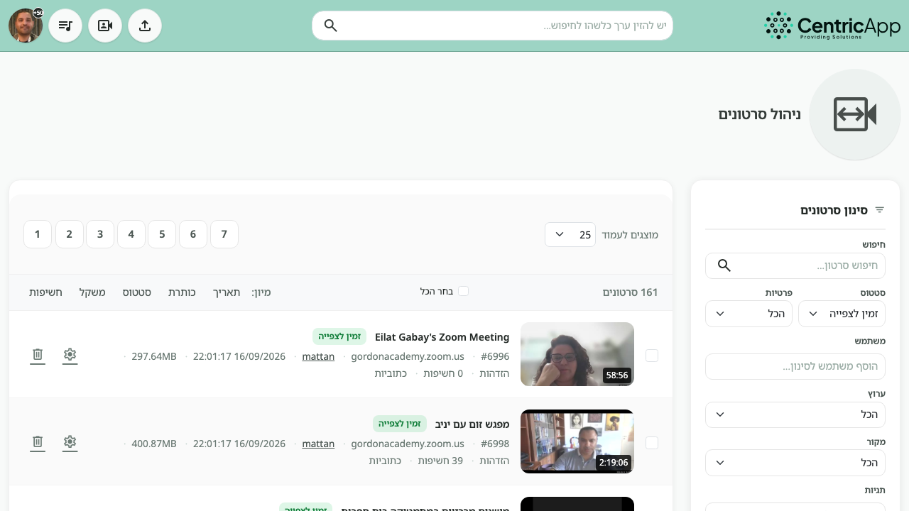
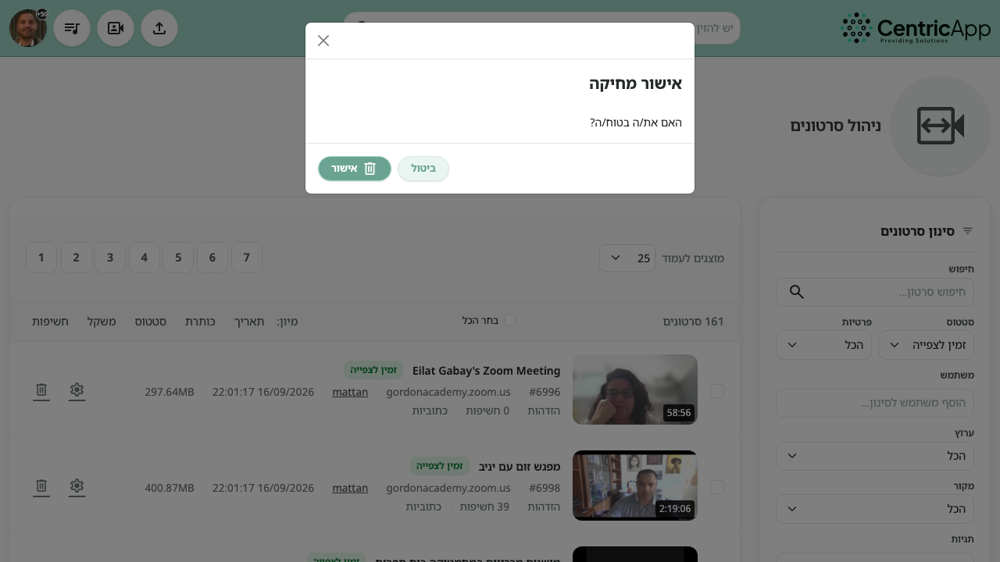
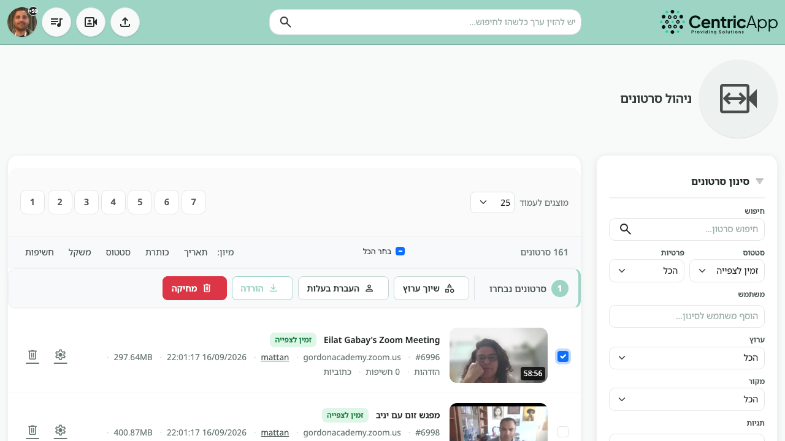
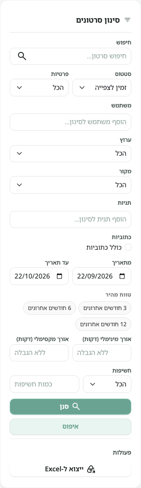

# מחיקת סרטונים מניהול הסרטונים

המדריך מתאר איך למחוק סרטון אחד או כמה סרטונים מעמוד **ניהול סרטונים**, ואיך להשתמש בסינון כדי למצוא אותם לפני המחיקה.

העמוד זמין למנהלי מערכת בכתובת ניהול הסרטונים (`videos/admin`).

## מה קורה במחיקה

מחיקה מהעמוד **לא מוחקת את הקובץ מיד**. הסרטון עובר לסטטוס **נמחק מהמערכת** ונעלם מרשימת ברירת המחדל (שמראה סרטונים **זמינים לצפייה**).

- צופים לא יכולים לפתוח את הסרטון.
- אפשר עדיין לראות אותו אם מסננים לפי הסטטוס **נמחק מהמערכת**.
- סרטון **נעול** לא נמחק. מופיעה הודעה עם שמות הסרטונים שנחסמו. כדי למחוק, מנהל צריך לבטל את הנעילה בעמוד עריכת הסרטון ולשמור.
- מחיקה לצמיתות של הקבצים מתבצעת רק אחרי תקופת ההמתנה שמוגדרת בהגדרות המערכת (**מחיקה צמיתה אחרי**, ברירת מחדל 90 יום). אחריה הסטטוס עובר ל**בארכיון**.

## מחיקת סרטון אחד

1. פתחו **ניהול סרטונים**.
2. אתרו את הסרטון (אפשר לסנן — ראו למטה).
3. בשורת הסרטון, לחצו על סמל הפח.
4. בחלון **אישור מחיקה** לחצו **אישור**. **ביטול** סוגר את החלון בלי למחוק.

אם במקום הפח מופיע מנעול, הסרטון נעול ואי אפשר למחוק אותו מכאן.

## מחיקה של כמה סרטונים

1. סמנו תיבת סימון ליד כל סרטון, או **בחר הכל** כדי לסמן את כל הסרטונים **בעמוד הנוכחי**.
2. יופיע סרגל פעולות עם מספר הסרטונים שנבחרו.
3. לחצו **מחיקה** ואשרו בחלון.

**בחר הכל** מסמן רק את העמוד שמוצג עכשיו (לפי **מוצגים לעמוד**), לא את כל תוצאות הסינון בכל העמודים.

## פעולות נוספות על סרטונים שנבחרו

אותו סרגל מופיע רק אחרי בחירה:

| פעולה | מה היא עושה |
| --- | --- |
| **שיוך ערוץ** | משייך את כל הסרטונים המסומנים לערוץ אחד. |
| **העברת בעלות** | מעביר את כל הסרטונים המסומנים למשתמש אחד. |
| **הורדה** | יוצר קובץ ZIP (עד 10 סרטונים). כשהקובץ מוכן הוא זמין בעמוד ההורדות ל־24 שעות. סרטוני YouTube וסרטונים שעדיין לא זמינים לצפייה לא נכללים. |
| **מחיקה** | מוחק (רכה) את כל הסרטונים המסומנים שאינם נעולים. |

בכל שורה יש גם כפתור **עריכה** (גלגל שיניים) שמעביר לעמוד הגדרות הסרטון.

## סינון

פאנל **סינון סרטונים** נמצא בצד. אחרי שינוי שדות לחצו **סנן**. **איפוס** מחזיר את הרשימה לברירת המחדל. **ייצוא ל־Excel** מייצא את התוצאות לפי הסינון הנוכחי.

ברירת המחדל של העמוד היא סטטוס **זמין לצפייה**, ותאריכים של החודש האחרון בערך. סרטונים בסטטוסים אחרים (כולל שנמחקו) לא יופיעו עד שמשנים את הסינון.

### חיפוש

חיפוש חופשי לפי טקסט בכותרת הסרטון.

### סטטוס

| סטטוס | משמעות |
| --- | --- |
| **הכל** | כל הסטטוסים חוץ מ**נמחק מהמערכת**. |
| **ממתין להורדה** | הקובץ עדיין לא הורד מהמקור. |
| **ממתין לעיבוד** | הקובץ התקבל ומחכה לעיבוד. |
| **בעיבוד** | העיבוד רץ עכשיו. |
| **לפני פרסום** | העיבוד הסתיים והסרטון עדיין לא פורסם. |
| **זמין לצפייה** | הסרטון פורסם. זו ברירת המחדל. |
| **שגיאה בעיבוד** | העיבוד נכשל. |
| **בארכיון** | אין קובץ לניגון (למשל אחרי מחיקה צמיתה). |
| **נמחק מהמערכת** | נמחק מהרשימה אבל הקבצים עדיין קיימים עד תום תקופת ההמתנה. |

כדי לראות סרטונים שזה עתה נמחקו, בחרו **נמחק מהמערכת** ולחצו **סנן**.

### פרטיות

**הכל**, **ציבורי**, **הזדהות** (רק משתמשים מחוברים), או **קישור** (מי שיש לו את הקישור).

### משתמש

סינון לפי בעלי הסרטון. אפשר לבחור כמה משתמשים.

### ערוץ

סינון לפי ערוץ (תגית ערוץ) שאליו הסרטון משויך.

### מקור

השרת שממנו הסרטון הגיע (למשל שרת זום). לצד כל מקור מופיע מספר הסרטונים הזמינים לצפייה מאותו מקור. בחירת מקור מציגה את כל הסטטוסים של אותו מקור, חוץ מסרטונים שנמחקו.

### תגיות

סינון לפי תגיות. אפשר להוסיף כמה תגיות.

### כתוביות

סימון **כולל כתוביות** משאיר רק סרטונים שיש להם כתוביות.

### מתאריך / עד תאריך

טווח לפי תאריך יצירת הסרטון.

### טווח מהיר

קיצורים שממלאים את התאריכים: **3 חודשים אחרונים**, **6 חודשים אחרונים**, **12 חודשים אחרונים**.

### אורך מינימלי / מקסימלי (דקות)

סינון לפי משך הסרטון. שדה ריק הוא **ללא הגבלה**.

### חשיפות

מספר הצפיות/החשיפות: **הכל**, **גדול מ**, או **קטן מ**, יחד עם כמות.

## מיון ותצוגה

מעל הרשימה:

- **מוצגים לעמוד** — כמה סרטונים בעמוד (למשל 25).
- **מיון** — לפי תאריך, כותרת, סטטוס, משקל או חשיפות.
- מספר התוצאות (**N סרטונים**) מתייחס לסינון הנוכחי, לא רק לעמוד שעל המסך.

בכל כרטיס סרטון מופיעים מזהה, מקור, בעלים, תאריך, גודל קובץ, פרטיות, מספר חשיפות, ואם יש כתוביות.
